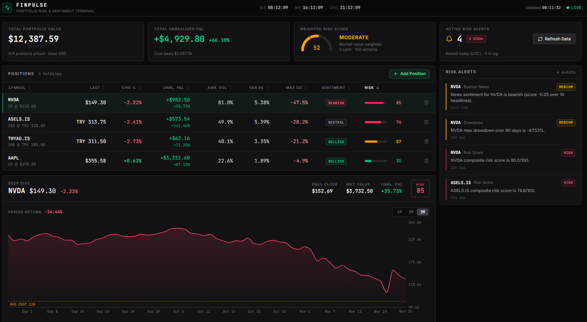
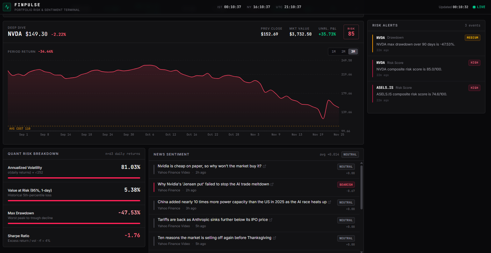
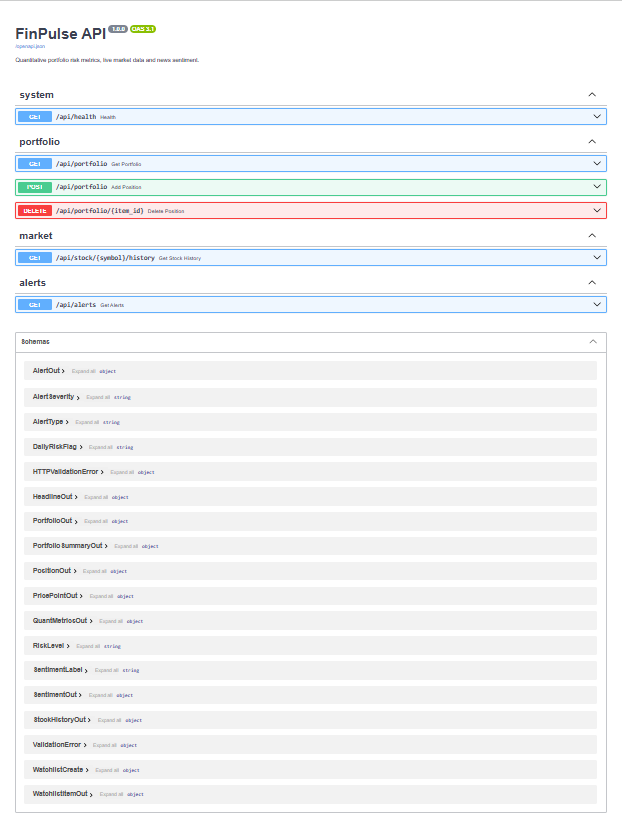

# FinPulse — Quantitative Portfolio Risk & Market Sentiment Terminal

[](https://github.com/itu-itis25-cerrah24/finpulse-risk-platform/actions/workflows/ci.yml)

A full-stack risk analytics terminal for mixed **BIST (Borsa Istanbul)** and **global equity** portfolios. FinPulse pulls live market data, computes institutional risk metrics from return distributions, scores news sentiment with NLP, and condenses everything into a single composite risk score and an alert stream, presented in a dark, Bloomberg-inspired dashboard.



---

## Engineering Highlights

| Area | What it does |
| --- | --- |
| **Quant risk engine** | Vectorized NumPy computation of **Annualized Volatility** (σ × √252), **95% Historical VaR** (1-day, empirical 5th percentile), **Max Drawdown** (running-peak method) and **Sharpe Ratio** (4% risk-free rate) from 90 days of daily returns. Pure functions with no I/O, so every metric is unit-tested against hand-calculated values. |
| **Portfolio correlation matrix** | Pairwise **Pearson correlation** of daily returns. Prices are first **inner-joined on common trading dates**, because BIST and NYSE holidays differ, so every return covers the same calendar interval for every symbol. Pairs above ρ = 0.70 are flagged as concentration risk in a hover-enabled heatmap. |
| **Benchmark comparison** | Each stock can be overlaid on its benchmark (**SPY** for US equities, **XU100.IS** for BIST). Both series are rebased to **0% cumulative return** at the start of the selected 1M/2M/3M window, with excess return, **beta** (Cov/Var) and correlation shown alongside. |
| **Composite risk score (0–100)** | Weighted blend of volatility, VaR, drawdown, daily move and news sentiment. Each factor is scaled against a "maximum risk" cap, and weights are **re-normalized when a factor is unavailable**, so a missing news feed never skews the score. |
| **NLP sentiment** | VADER scores every headline (`BULLISH` / `BEARISH` / `NEUTRAL` at ±0.05 compound), then aggregates per symbol. |
| **5-minute TTL caching** | A thread-safe `cachetools.TTLCache` wraps every Yahoo Finance call. Repeat dashboard loads drop from ~5.7 s to ~6 ms. Failed lookups are deliberately **not cached**, so the next request retries. |
| **Multi-currency USD normalization** | TRY- and USD-denominated positions are converted to USD with live FX rates (`TRY=X`) before portfolio totals and the **market-value-weighted** risk score are computed. |
| **Thread-safe alert deduplication** | Alert rules (sharp drop/spike, high risk score, bearish news, deep drawdown) are pure functions. Persistence uses a check-then-insert under a lock, so concurrent refreshes (multiple tabs, React StrictMode) never store the same alert twice in one day. |
| **Concurrent data fetching** | Positions are analyzed in parallel with a `ThreadPoolExecutor`, since the work is network-bound. |
| **Graceful degradation** | Missing prices, empty news or upstream outages return well-defined fallbacks instead of 500s. The UI shows `NO DATA` or an offline state. |
| **68 automated tests + CI** | `pytest` suite covering every quant metric, correlation, date alignment, beta and benchmark rebasing, risk-score edge cases, sentiment and P&L, plus API tests that run against an in-memory database and a fake market data provider (no network needed). **GitHub Actions** runs the backend tests and the strict TypeScript check and production build on every push and pull request to `main`. |

---

## Screenshots

**Quant risk & sentiment deep dive.** 90-day price chart with average-cost reference line, quant breakdown, and scored news feed.



**FastAPI interactive docs.** Fully typed request/response schemas generated from Pydantic models.



---

## Tech Stack

**Backend**
- Python 3.11+ · FastAPI · Uvicorn
- SQLAlchemy 2.0 (typed `Mapped[]` models) · SQLite
- NumPy (quant engine) · yfinance (market data) · vaderSentiment (NLP)
- cachetools (TTL cache) · Pydantic v2 (validation & API schemas)
- pytest · httpx (`TestClient`)

**Frontend**
- React 19 · TypeScript (strict) · Vite
- Tailwind CSS v4 · Recharts · lucide-react

**Infrastructure**
- Docker (multi-stage builds) · Docker Compose · Nginx (static hosting + reverse proxy)
- GitHub Actions (CI: pytest, strict type-check, production build)

---

## Architecture

```
 ┌──────────────────────────────────────────────────────────────────────┐
 │  Browser — React + TypeScript SPA                                    │
 │  KPI bar · Positions table · Deep-dive chart · News · Alerts feed    │
 └───────────────────────────────┬──────────────────────────────────────┘
                                 │  same-origin  /api/*
 ┌───────────────────────────────▼──────────────────────────────────────┐
 │  Nginx (frontend container)   static assets + reverse proxy /api     │
 └───────────────────────────────┬──────────────────────────────────────┘
                                 │  http://backend:8000
 ┌───────────────────────────────▼──────────────────────────────────────┐
 │  FastAPI (backend container)                     main.py · schemas   │
 │                                                                      │
 │   portfolio_service ──► risk_engine (NumPy · VADER, pure functions)  │
 │          │                                                           │
 │          ├──────────► market_service ──► TTLCache (5 min, locked)    │
 │          │                   │                                       │
 │          ▼                   ▼                                       │
 │   alert_service       Yahoo Finance API (quotes · history · news ·   │
 │   (rules + dedupe)                       FX rates)                   │
 │          │                                                           │
 │          ▼                                                           │
 │   SQLAlchemy ──► SQLite  (watchlist_items · risk_alerts)             │
 └──────────────────────────────────────────────────────────────────────┘
```

**Request flow for `GET /api/portfolio`:** load watchlist rows → fetch quote, 90-day history and news for each symbol in parallel (served from cache when warm) → compute quant metrics, sentiment, P&L and risk score → convert to USD and aggregate → evaluate alert rules and persist new alerts → return one typed JSON payload.

### Repository layout

```
finpulse-risk-platform/
├── backend/
│   ├── main.py                 # FastAPI app, routes, dependency injection
│   ├── database.py             # Engine, session factory, get_db dependency
│   ├── models.py               # WatchlistItem, RiskAlert ORM models
│   ├── schemas.py              # Pydantic request/response contracts
│   ├── seed.py                 # Default watchlist (THYAO.IS, ASELS.IS, AAPL, NVDA)
│   ├── services/
│   │   ├── market_service.py   # yfinance facade + TTL cache + FX
│   │   ├── risk_engine.py      # Volatility, VaR, drawdown, Sharpe, sentiment, score
│   │   ├── portfolio_service.py# Orchestration + USD aggregation
│   │   └── alert_service.py    # Alert rules + deduplicated persistence
│   ├── tests/                  # 68 pytest tests
│   └── Dockerfile
├── frontend/
│   ├── src/
│   │   ├── api/                # Typed client + response types
│   │   ├── hooks/              # useDashboard, useStockDetail
│   │   ├── components/         # KPI bar, table, deep dive, alerts, modal
│   │   └── lib/format.ts       # Number/currency formatting, semantic colors
│   ├── nginx.conf
│   └── Dockerfile
├── .github/workflows/ci.yml    # CI pipeline
├── docs/                       # Screenshots
└── docker-compose.yml
```

---

## Quick Start

### Option A: Docker (recommended)

Requires Docker Desktop (or Docker Engine with the Compose plugin).

```bash
docker compose up --build
```

| Service | URL |
| --- | --- |
| Dashboard | http://localhost:8080 |
| API docs (Swagger UI) | http://localhost:8000/docs |

The SQLite database lives in the named volume `finpulse-data`, so your watchlist survives restarts. Run `docker compose down -v` to reset it.

### Option B: Local development

Requires **Python 3.11+** and **Node.js 20.19+**.

**1. Backend** (terminal 1)

```bash
cd backend
python -m venv .venv
# Windows:  .\.venv\Scripts\Activate.ps1
# macOS/Linux: source .venv/bin/activate
pip install -r requirements.txt
pytest                                   # 68 tests
uvicorn main:app --reload --port 8000
```

**2. Frontend** (terminal 2)

```bash
cd frontend
npm install
npm run dev
```

Open http://localhost:5173. The Vite dev server proxies `/api` to `http://127.0.0.1:8000`.

On first startup the backend seeds a demo portfolio of `THYAO.IS`, `ASELS.IS`, `AAPL` and `NVDA`.

### Configuration

| Variable | Default | Purpose |
| --- | --- | --- |
| `FINPULSE_DATABASE_URL` | SQLite file at `backend/finpulse.db` | SQLAlchemy database URL |
| `FINPULSE_CORS_ORIGINS` | `http://localhost:5173,…` | Comma-separated allowed origins |
| `VITE_BACKEND_URL` | `http://127.0.0.1:8000` | Dev-server proxy target |
| `VITE_API_BASE_URL` | *(empty, same origin)* | API origin baked into production builds |

---

## API Endpoints

| Method | Endpoint | Description |
| --- | --- | --- |
| `GET` | `/api/portfolio` | All positions with live prices, quant metrics, sentiment and risk score, plus a USD portfolio summary (total value, P&L, weighted risk score). Also evaluates alert rules. |
| `POST` | `/api/portfolio` | Add a position `{symbol, shares, avg_cost, risk_threshold_pct}`. Validates the ticker against live data. Returns `201`, or `409` for a duplicate and `404` for an unknown symbol. |
| `DELETE` | `/api/portfolio/{item_id}` | Remove a position. Returns `204`, or `404` if not found. |
| `GET` | `/api/portfolio/correlation` | Pearson correlation matrix of date-aligned 90-day daily returns, average pairwise ρ, and pairs above 0.70 (concentration risk). |
| `GET` | `/api/stock/{symbol}/history` | 90-day closing prices, sentiment-scored headlines, quant metrics and risk score for any symbol. |
| `GET` | `/api/stock/{symbol}/benchmark?days=90` | Cumulative % return of the symbol vs SPY (or XU100.IS for `.IS` symbols), rebased to 0% at the window start, plus excess return, beta and correlation. Returns `503` if benchmark data is unavailable. |
| `GET` | `/api/alerts?limit=50&refresh=true` | Most recent risk alerts, newest first, with severity `LOW` / `MEDIUM` / `HIGH` / `CRITICAL`. |
| `GET` | `/api/health` | Liveness probe used by the Docker health check. |

---

## Risk Methodology

| Metric | Definition |
| --- | --- |
| Daily return | rₜ = Pₜ / Pₜ₋₁ − 1 on adjusted closes |
| Annualized volatility | sample std-dev(r) × √252 |
| 95% Historical VaR | −(5th percentile of r), floored at 0, reported as a positive 1-day loss % |
| Max drawdown | min(Pₜ / max(P₀…Pₜ) − 1) |
| Sharpe ratio | (mean(r) − 4% / 252) / std-dev(r) × √252 |
| Correlation | Pearson ρ of daily returns, computed on prices inner-joined by date |
| Beta | Cov(r_asset, r_benchmark) / Var(r_benchmark) |
| Cumulative return | (Pₜ / P_start − 1) × 100, rebased at the window start |
| Risk score | 30% volatility (cap 60%) · 25% VaR (cap 5%) · 20% drawdown (cap 40%) · 10% daily move (cap 10%) · 15% sentiment |
| Risk level | `LOW` < 35 ≤ `MODERATE` < 65 ≤ `HIGH` |

---

## Testing

```bash
cd backend
pytest -v
```

- `tests/test_risk_engine.py`: volatility, VaR, max drawdown and Sharpe against closed-form values; risk-score bounds, weighting and re-normalization; sentiment classification; P&L and daily-move flags.
- `tests/test_correlation_benchmark.py`: cross-market date alignment, Pearson correlation (±1, hand-calculated, zero-variance and too-few-observation cases), pair ranking, benchmark selection, rebasing, beta and windowing.
- `tests/test_api.py`: full CRUD, correlation and benchmark endpoints, validation (`409` / `404` / `422`), stock history and alert deduplication, using an in-memory SQLite database and a deterministic fake market data provider.

```bash
cd frontend
npm run build    # strict TypeScript check + production bundle
```

---

## Disclaimer

FinPulse is an educational and portfolio project. Market data comes from Yahoo Finance via the unofficial `yfinance` library and may be delayed or incomplete. Nothing in this application constitutes investment advice.
